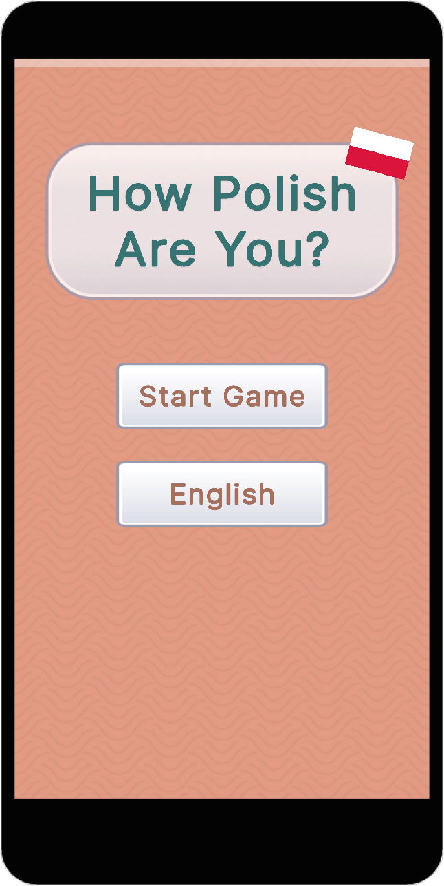
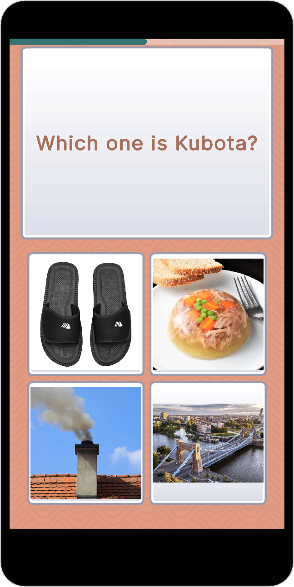
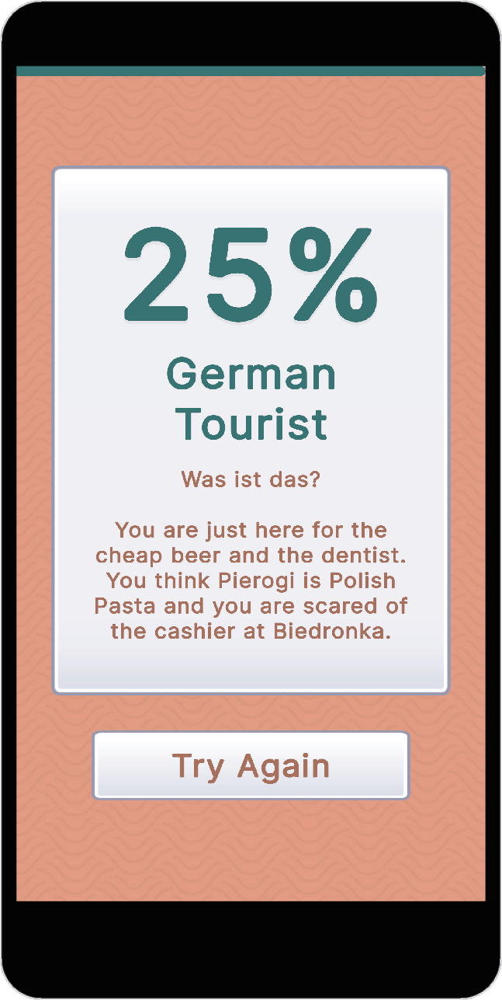

# 🎯 How X Are You?

A data-driven, expandable quiz game framework built in Unity. Test players' knowledge about any country or topic with localized questions, tiered results, and a charming Boho Matte visual style.


<p align="center">
  
  
  
</p>


---

## ✨ Features

- **🌍 Multi-Country Support** — Create unlimited country profiles with unique questions, tiers, and localization
- **🔀 Randomized Gameplay** — Questions and answers shuffle every playthrough
- **🌐 Bilingual** — Toggle between English and native language instantly
- **📊 Tiered Results** — 8 result tiers with unique titles, subtitles, and descriptions
- **📱 Mobile-First** — Responsive UI designed for WebGL on mobile browsers
- **🎨 Boho Matte Theme** — Warm, inviting visual style with custom assets
- **📝 CSV-Driven** — All content managed via spreadsheets for easy editing
- **🔊 Dynamic Audio** — Randomized SFX pitch for satisfying feedback

---

## 🎮 Play Now

> 🔗 **[Play on itch.io](https://bluebuckgames.itch.io/how-polish-are-you)**

---

## 🚀 Quick Start

### Requirements

- Unity **6.2+** (LTS recommended)
- UI Toolkit (included in Unity)

### Setup

1. **Clone the repository**
   ```bash
   git clone https://github.com/YOUR_USERNAME/how-x-are-you.git
   ```

2. **Open in Unity**
   - Open Unity Hub
   - Click "Add" → Navigate to cloned folder
   - Open project with Unity 6.2+

3. **Open the main scene**
   ```
   Assets/Scenes/MainGame.unity
   ```

4. **Press Play** — The Polish profile is pre-configured

---

## 📁 Project Structure

```
Assets/
├── Data/
│   └── PL/                      # Country profile folder
│       ├── Images/              # Question & answer images
│       │   ├── Q_00.png         # Question image (ID: 00)
│       │   ├── Q_01_00.png      # Answer image (Q01, Answer 0)
│       │   └── Flag.png         # Country flag
│       ├── How X Are You - PL Quiz.csv
│       ├── How X Are You - PL Tier.csv
│       └── How X Are You - PL UI.csv
│
├── Scripts/
│   ├── Core/
│   │   ├── GameController.cs    # Main game loop & UI
│   │   ├── AudioController.cs   # Music & SFX management
│   │   └── GameEvents.cs        # Event system
│   ├── Data/
│   │   ├── QuizProfile.cs       # ScriptableObject definition
│   │   ├── QuestionData.cs      # Question structure
│   │   ├── TierData.cs          # Result tier structure
│   │   ├── UIData.cs            # UI strings structure
│   │   └── LocalizedText.cs     # Bilingual text wrapper
│   └── Editor/
│       └── QuizProfileEditor.cs # CSV import & validation
│
├── UI/
│   ├── Themes/
│   │   └── BaseTheme.uss        # Main stylesheet
│   ├── Layouts/
│   │   └── MainGame.uxml        # UI structure
│   └── Textures/                # UI assets (buttons, frames, backgrounds)
│
└── Scenes/
    └── MainGame.unity           # Main scene
```

---

## 📝 Creating a New Country Profile

### Step 1: Create Folder Structure

```
Assets/Data/XX/                  # XX = country code (e.g., TR, DE, JP)
├── Images/
│   └── Flag.png
├── How X Are You - XX Quiz.csv
├── How X Are You - XX Tier.csv
└── How X Are You - XX UI.csv
```

### Step 2: Create ScriptableObject

1. Right-click in Project window
2. **Create → HowX → Country Profile**
3. Name it (e.g., `Profile_Turkey`)

### Step 3: Configure Profile

| Field | Example | Description |
|-------|---------|-------------|
| Country Name | `Turkey` | Display name |
| Country Adjective | `Turkish` | Used in title: "How Turkish Are You?" |
| Native Language Name | `Türkçe` | For reference |
| Folder Name | `TR` | Must match folder in Assets/Data/ |

### Step 4: Prepare CSV Files

Assign your CSV files to the profile, then click the import buttons:

1. **IMPORT QUESTIONS (CSV)** — Green button
2. **IMPORT TIERS (CSV)** — Cyan button  
3. **IMPORT UI & FLAGS (CSV)** — Yellow button
4. **VALIDATE PROFILE** — Magenta button (check for errors)

---

## 📊 CSV Format Reference

### 📋 Google Sheet Template

> **[📄 View Template on Google Sheets](https://docs.google.com/spreadsheets/d/1ct-ShL0a72dP0yXP25wbkmHo9trunVviVYG2tVhin0E/edit?usp=sharing)**
> 
> This template contains 3 tabs: **Quiz**, **Tier**, and **UI**. You can:
> - 📝 **Comment** on the sheet to suggest improvements
> - 📋 **Make a copy** (File → Make a copy) to create your own country profile
> - ⬇️ **Export as CSV** (File → Download → Comma-separated values) for each tab

---

### Questions CSV

| Column | Type | Description |
|--------|------|-------------|
| ID | Integer | Unique question ID (0, 1, 2...) |
| CorrectIndex | String | Correct answer(s): `0` or `0,1` for multiple |
| Q_EN | String | Question text (English) |
| Q_Native | String | Question text (Native language) |
| Use Question Image | Boolean | `TRUE` if question has image |
| Use Answer Image | Boolean | `TRUE` if answers are images |
| A0_EN, A0_Native | String | Answer 0 (typically correct) |
| A1_EN, A1_Native | String | Answer 1 |
| A2_EN, A2_Native | String | Answer 2 |
| A3_EN, A3_Native | String | Answer 3 |

**Example:**
```csv
ID,CorrectIndex,Q_EN,Q_Native,Use Question Image,Use Answer Image,A0_EN,A0_Native,A1_EN,A1_Native,A2_EN,A2_Native,A3_EN,A3_Native
0,0,Where is Poland located?,Gdzie leży Polska?,TRUE,FALSE,Next to Russia unfortunately,Obok Rosji niestety,In the Middle East,Na Bliskim Wschodzie,It's a city in Germany,To miasto w Niemczech,On the Moon,Na Księżycu
```

### Tiers CSV

| Column | Type | Description |
|--------|------|-------------|
| MaxPercent | Float | Maximum score % for this tier |
| Title_EN | String | Tier title (English) |
| Title_Native | String | Tier title (Native) |
| Subtitle_EN | String | Short subtitle (English) |
| Subtitle_Native | String | Short subtitle (Native) |
| Desc_EN | String | Full description (English) |
| Desc_Native | String | Full description (Native) |

**Example:**
```csv
MaxPercent,Title_EN,Title_Native,Subtitle_EN,Subtitle_Native,Desc_EN,Desc_Native
25,Tourist,Turist,Just visiting,Sadece ziyaret,You need to explore more!,Daha fazla keşfetmelisin!
50,Enthusiast,Meraklı,Getting there,Yolda,You know the basics!,Temelleri biliyorsun!
```

### UI CSV

| Key | EN | Native |
|-----|-----|--------|
| btn_start | Start Game | Oyuna Başla |
| btn_restart | Try Again | Tekrar Dene |
| btn_lang | English | Türkçe |
| title_template | How {0} Are You? | Ne Kadar {0}sin? |

---

## 🖼️ Image Naming Convention

| Type | Pattern | Example |
|------|---------|---------|
| Question Image | `Q_{ID}.png` | `Q_05.png` |
| Answer Image | `Q_{ID}_{AnswerIndex}.png` | `Q_05_00.png`, `Q_05_01.png` |
| Flag | `Flag.png` | `Flag.png` |

- IDs are **zero-padded** to 2 digits: `00`, `01`, `02`...
- Answer indices: `00`, `01`, `02`, `03`

---

## 🎨 Customizing the Theme

The visual style is defined in `Assets/UI/Themes/BaseTheme.uss`:

```css
:root {
    --theme-bg: rgb(231, 158, 133);       /* Terra Cotta */
    --card-bg: rgba(255, 248, 245, 0.95); /* Warm White */
    --theme-accent: rgb(56, 115, 115);    /* Deep Teal */
    --hover-bg: rgb(240, 213, 154);       /* Maize Yellow */
    --text-main: rgb(56, 115, 115);       /* Deep Teal */
    --text-body: rgb(166, 112, 93);       /* Muted Clay */
}
```

Custom assets are in `Assets/UI/Textures/`:
- `Backgrounds/bg_pattern.png` — Tileable background
- `Buttons/button_square_gradient.png` — 9-slice button/panel frame
- `Buttons/button_round_gradient.png` — 9-slice rounded frame

---

## 🏗️ Building for WebGL

1. **File → Build Settings**
2. Select **WebGL** platform
3. Click **Switch Platform**
4. **Player Settings:**
   - Compression Format: **Brotli** (for itch.io)
   - Memory Size: **256 MB** (adjust if needed)
   - Enable **Decompression Fallback**
5. Click **Build**

### Deploying to itch.io

1. Create a new project on itch.io
2. Set **Kind of project** to **HTML**
3. Upload your WebGL build as a `.zip`
4. Check **This file will be played in the browser**
5. Set viewport dimensions (recommended: **960 x 600** or **responsive**)

---

## 🤝 Contributing

Contributions are welcome! Here's how you can help:

### Adding a New Country Profile

1. Fork the repository
2. Create your country folder in `Assets/Data/`
3. Prepare CSV files and images
4. Test thoroughly with **VALIDATE PROFILE**
5. Submit a Pull Request

### Guidelines

- Follow existing code style
- Test on both desktop and mobile browsers
- Ensure all text has both EN and Native translations
- Keep questions family-friendly and culturally respectful

---

## 📄 License

This project is licensed under the **MIT License** — see the [LICENSE](LICENSE) file for details.

---

## 🙏 Acknowledgments

- Built with [Unity UI Toolkit](https://docs.unity3d.com/Manual/UIElements.html)
- Inspired by BuzzFeed-style personality quizzes
- Boho Matte color palette

---

## 📬 Contact

- **itch.io:** [Bluebuck](https://bluebuckgames.itch.io/)
- **GitHub:** [@kerem-sirin](https://github.com/kerem-sirin)

---

<p align="center">
  Made with ❤️ and way too many pierogi references
</p>
